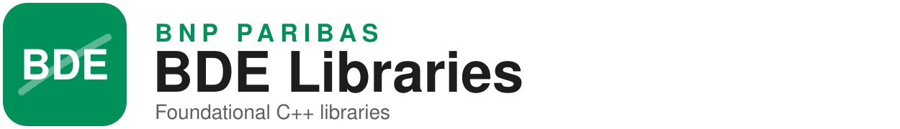

<p align="center">
  <a href="https://github.com/joao-cognition/bde-c-">
    <picture>
      <source media="(prefers-color-scheme: dark)" srcset="docs/brand/bde_logo_label_dark.svg">
      
    </picture>
  </a>
</p>

[](#)
[](LICENSE)
[](#)

BDE Libraries
=============

This repository contains the BDE libraries, currently BSL (Basic Standard
Library), BDL (Basic Development Library), BAL (Basic Application Library), and
BBL (Basic Business Library).

Documentation and Build Links
=============================

For more information about BDE libraries follow the links below.

Upstream (open source)
----------------------

* [Online Library Documentation](https://bloomberg.github.io/bde)
* [BDE Build Tools](https://bloomberg.github.io/bde-tools/)
* [BDE Build Instructions](https://bloomberg.github.io/bde/library_information/build.html)


BNP Paribas (internal)
-----------------------

* [Online Library Documentation](https://bde.bnpparibas.com/bde)
* [BDE Build Tools](https://bde.bnpparibas.com/bde-tools/)
* [BDE Build Instructions](https://bde.bnpparibas.com/bde/library_information/build.html)


Build Instructions
==================
BDE uses a build system based on [cmake](https://cmake.org).  The build system is located in the
BDE tools repository (see [Documentation Links](#documentation-links)).

* [Build instructions for open source users](https://bloomberg.github.io/bde/library_information/build.html)
* [Build instructions for BNP Paribas users](https://bde.bnpparibas.com/bde/library_information/build.html)

Prerequisites
-------------
The BDE CMake build system requires the following software to be preinstalled and configured on the system:

* [CMake](https://cmake.org) version 3.12 or later
* [Ninja](https://ninja-build.org/) (recommended) or GNU Make
* [Python](https://www.python.org/)

Note that `python` is used by the build helpers `bde_build_env.py` and `cmake_build.py`, but is not strictly needed
to build BDE.  See the more complete build instructions linked below for more detail.

Build Instructions (Open Source)
--------------------------------
Please see the more complete [build instructions for open source users](https://bloomberg.github.io/bde/library_information/build.html).

The following commands can be used to configure and build the BDE repository:
1. Clone the `bde-tools` and `bde` repositories and add `bde-tools` to your `PATH`:
   ```shell
   $ git clone https://github.com/bloomberg/bde-tools.git
   $ export PATH=$PWD/bde-tools/bin:$PATH      # add bde-tools to the 'PATH'
   $ git clone https://github.com/joao-cognition/bde-c-.git
   $ cd bde
   ```

2. From the root of this source repository, run:

   ```shell
   $ export BDE_CMAKE_BUILD_DIR=$PWD/_build   # configure the build directory
   $ bbs_build configure -u opt_dbg_64_cpp17
   ```

3. To build the libraries, but not the test drivers, run:

   ```shell
   $ bbs_build build
   ```

   To also build the test drivers, run:

   ```shell
   $ bbs_build build --test build
   ```

   To build and run the test drivers, run:

   ```shell
   $ bbs_build build --test run
   ```

Build Instructions (BNP Paribas)
---------------------------------
Please see the more complete [build instructions for BNP Paribas users](https://bde.bnpparibas.com/bde/library_information/build.html).

The following commands can be used to configure and build the BDE repository:
1. Clone the `bde-tools` and `bde` repositories and add `bde-tools` to your `PATH`:
   ```shell
   $ git clone bbgithub:bde/bde-tools
   $ export PATH=$PWD/bde-tools/bin:$PATH      # add bde-tools to the 'PATH'
   $ git clone bbgithub:bde/bde
   $ cd bde
   ```

2. From the root of this source repository, run:

   ```shell
   $ export BDE_CMAKE_BUILD_DIR=$PWD/_build   # configure the build directory
   $ bbs_build configure -u opt_dbg_64_cpp17
   ```

3. To build the libraries, but not the test drivers, run:

   ```shell
   $ bbs_build build
   ```

   To also build the test drivers, run:

   ```shell
   $ bbs_build build --test build
   ```

   To build and run the test drivers, run:

   ```shell
   $ bbs_build build --test run
   ```

License
=======
The BDE libraries are distributed under the Apache License (version 2.0); see
the LICENSE file at the top of the source tree for more information.
